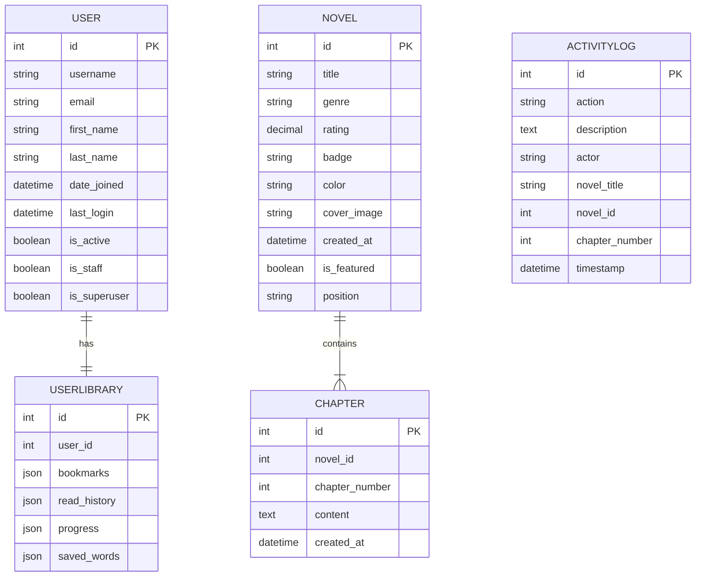

# Entity Relationship Diagram (ERD) - Django Novel Project

## Overview

This ERD represents the database schema for a Django-based novel reading platform. The system manages novels, chapters, user libraries (bookmarks, reading history, progress), and activity logging.

## ERD Diagram

## Relationships

| From | To | Type | Description |
|------|-----|------|-------------|
| User | UserLibrary | One-to-One | Each user has exactly one library for bookmarks, history, and progress |
| Novel | Chapter | One-to-Many | Each novel can have multiple chapters |
| ActivityLog | Novel | Reference | ActivityLog references novels by ID/title (denormalized) |

## Entity Descriptions

### 1. User (Django Auth)
- Django's built-in authentication model
- Serves as the base for user accounts
- Linked to UserLibrary via OneToOne relationship

### 2. UserLibrary
- Stores user-specific reading data
- **bookmarks**: JSON array of bookmarked novel IDs
- **read_history**: JSON array tracking read chapters
- **progress**: JSON dictionary storing reading progress per novel

### 3. Novel
- Represents a novel/manga in the system
- Contains metadata like title, genre, rating, and cover image
- **is_featured**: Controls visibility in featured section
- **position**: CSS position for cover image display

### 4. Chapter
- Represents individual chapters of a novel
- Linked to Novel via ForeignKey (cascade delete)
- Ordered by chapter_number

### 5. ActivityLog
- Tracks all administrative actions in the system
- Denormalized design for efficient querying
- Records actions like novel creation, updates, user management, etc.

## Database Schema Summary

| Table | Primary Key | Foreign Keys | Purpose |
|-------|-------------|--------------|---------|
| auth_user | id | - | User authentication |
| myapp_userlibrary | id | user_id → auth_user.id | User reading data |
| myapp_novel | id | - | Novel metadata |
| myapp_chapter | id | novel_id → myapp_novel.id | Chapter content |
| myapp_activitylog | id | - | Activity tracking |